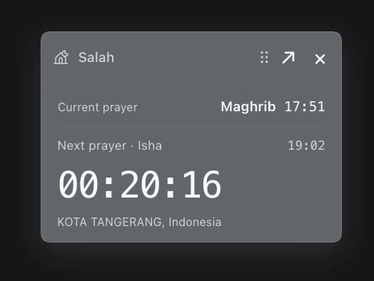
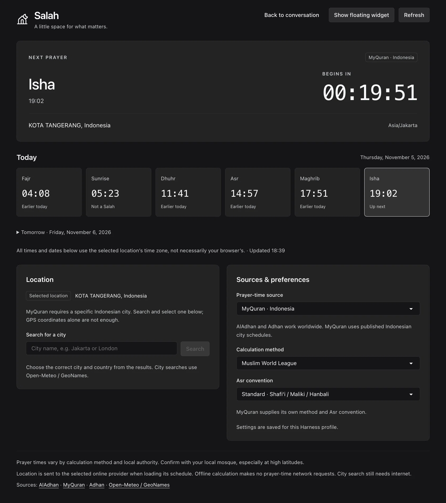

# Salah for DeepSeek Harness

Prayer times, a next-prayer countdown, and a floating widget—right inside Harness.




*Sample times only; the timetable screenshot shows an earlier interface.*

## Install from npm

When `@ienugr/dsh-salah@1.2.1` is public, ask Harness:

> First list bundles. If `@local/dsh-salah` or `@icanhcorpse/dsh-salah` is installed, stop and follow [Previous installations](#previous-installations). Then install `@ienugr/dsh-salah@1.2.1` with `plugin_manager` using the public npm registry.

**Before running this JSON, migrate any existing Salah bundle using the steps below.**

```json
{
  "action": "install_bundle",
  "target": "@ienugr/dsh-salah@1.2.1",
  "registry": "https://registry.npmjs.org"
}
```

No global npm install, CLI, clone, or build is needed. Follow the manager's `application` and `nextStep`; restart or refresh if requested.

**Requirements:** Harness `0.2.1-rc.5`; Node.js `>=22.15` on the Host. Other Harness versions are not validated.

## Quick setup

1. Choose **AlAdhan**, **MyQuran**, or **Adhan**.
2. Select a city or enter coordinates and a time zone. GPS is used only after you choose **Use current location** and grant browser permission.
3. Review the source and location, check all three acknowledgements, then select **Confirm reviewed setup**.

MyQuran uses its own city directory and published timetable; method and Asr settings apply only to offline fallback.

## What you get

- Today's and tomorrow's timetable, plus a live next-prayer countdown.
- A compact widget you can drag, move by keyboard, hide, and reopen.
- Clear source, freshness, and offline-fallback labels.
- Local Adhan calculations when you want prayer times without an API request.

## Previous installations

The old local bundle is `@local/dsh-salah`. The GitHub [`v1.2.0` release](https://github.com/ienugr/dsh-salah/releases/tag/v1.2.0) is also available as a **legacy** `@icanhcorpse/dsh-salah` bundle. The follow-up `v1.2.1` release will provide release notes and trigger npm publication; install the new scope from npm once it is public.

Do not run the new package alongside either old bundle. In Plugin Manager:

1. List bundles and identify every legacy name: `@local/dsh-salah` and/or `@icanhcorpse/dsh-salah`.
2. Remove each installed legacy bundle and complete its unload/restart instructions before installing the new one. Do not delete settings or browser data.
3. Install `@ienugr/dsh-salah@1.2.1` from npm once available.

Storage domain `salah_preferences` and browser view keys stay the same. Reusing Host preferences requires the same Harness profile and storage backend; browser view state also requires the same browser and origin. Current GPS fixes are transient, and privacy normalization may have removed older saved GPS data. See [Privacy](<PRIVACY.md>).

## Prayer-time sources

| Source | Coverage | Use |
| --- | --- | --- |
| **AlAdhan** | Worldwide | Online times using your selected method and Asr convention. |
| **MyQuran** | Indonesian cities | The selected city's published timetable. |
| **Adhan** | Local | Calculates on the Host from coordinates, time zone, method, and Asr convention. |

Methods and published timetables can differ; check local guidance. Unsupported polar conditions are reported as unavailable. Online sources and city search depend on provider availability and terms.

### City search

Open-Meteo's public endpoint is the default and is for non-commercial use. Licensed customers can explicitly select the commercial endpoint with a Host-managed `SALAH_OPEN_METEO_API_KEY`. The key is never shown in the interface or tool. Failed commercial searches do not silently fall back to public mode.

## Widget and agent tool

The widget stays inside Harness panels, not above other desktop apps. Drag it or use arrow keys; **×** hides it, the Prayer times page reopens it, and **Reset widget position** restores placement.

The `salah_times` tool supports `status`, `search`, `times`, and `configure`. It cannot request GPS permission or obtain a device location. Explicit tool arguments and results may appear in session history.

## Development and license

See [Contributing](<CONTRIBUTING.md>) for builds and tests, [Publishing](<docs/PUBLISHING.md>) for npm release status, and [Third-party notices](<THIRD_PARTY_NOTICES.md>) for attribution and service terms.

Plugin source and artwork are provided under the [MIT License](<LICENSE>). Salah is independent of the cited schedule, mapping, and geocoding services.
